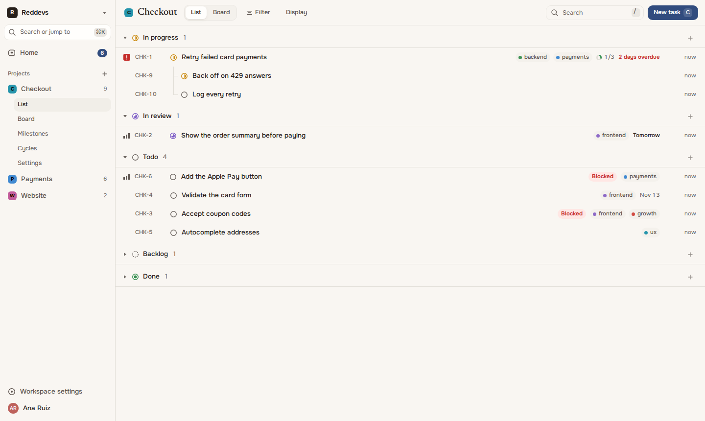

# project-management

A self-hosted project management tool for teams where AI coding agents work next to people. Agents are members
of the workspace with their own scoped API keys, and every change they make reads "claude-dev for Ana Ruiz":
the agent, and the person it acts for. People use the web app; agents use the `pm` CLI.



What works today (milestone M2):
- First-run setup, email and password sign-in, single sign-on with OpenID Connect, invitations by link.
- Projects and tasks: a keyboard-first task list (J/K, C to create, Esc), a task pane and a task page, with
  status, priority, assignee and a Markdown description.
- A board per project, one column per status. Move cards by drag and drop or with Shift+H/J/K/L, undo with
  Ctrl+Z, and split the board into swimlanes by assignee or milestone. V switches between list and board.
- Milestones with a target date and progress, and numbered cycles. A cycle ends at midnight after its end
  date, or early by hand, and moves its unfinished tasks to the next one.
- Comments in the task history, in Markdown, with @mentions of people and agents. The history shows
  comments and changes in one list.
- My tasks: everything assigned to you, across projects.
- Light, dark or system theme, saved to your account.
- Agents with API keys scoped to some or all projects, read only or read and write, revocable at any time.
- The `pm` CLI with `--json` output and stable exit codes, over a REST API at `/api/v1` with an OpenAPI
  document. Agents comment, plan with milestones and cycles, and list their own tasks with `--mine`.
- One Docker image (web, worker, migrations) and a docker compose file. Postgres is the only stateful service.

## Quickstart

You need Docker with the Compose plugin.

```sh
git clone https://gitlab.com/reddevsdotio/tooling/project-management.git
cd project-management
cp .env.example .env
# set BETTER_AUTH_SECRET in .env, for example to the output of: openssl rand -base64 32
docker compose up -d --build
```

Open http://localhost:3000, create the admin account and name your workspace. Create a project, then add an
agent in Settings > Members and copy its key. The image ships the CLI, so you can try the key right away:

```sh
docker compose exec -e PM_KEY=pm_live_... web pm tasks list --project PAY
```

On the agent's machine, build the CLI and set `PM_URL` and `PM_KEY`, as described in
[docs/agents.md](docs/agents.md).

## Docs

- [Self-hosting](docs/self-hosting.md): configuration, first run, ports, backups and upgrades.
- [Agents](docs/agents.md): adding agents, scoping keys, running `pm` in an agent's environment, `--json` output.
- [CLI reference](apps/cli/README.md): every `pm` command and option.

## Development

Node 24 and pnpm (the version in `package.json`):

```sh
pnpm install
cp .env.example .env                                   # then set BETTER_AUTH_SECRET
docker compose -f docker-compose.dev.yml up -d db      # Postgres on localhost:5432
pnpm --filter @pm/db migrate
pnpm dev                                               # web app on http://localhost:3000, plus the worker
```

Checks:

```sh
pnpm lint
pnpm typecheck
pnpm test                                     # Vitest against a throwaway Postgres database
pnpm exec playwright install chromium         # once
pnpm e2e                                      # Playwright against the docker compose stack
```

`pnpm e2e` builds the CLI and the image, starts the compose stack as project `pm-e2e` on a fresh volume at
http://localhost:3100 and runs the specs in `e2e/` in file order, then removes the stack. It leaves the
development database alone.
- `person-and-agent.spec.ts`: the M1 flow on a new server, from setup to an agent working through the CLI.
  It runs first because it sets the server up.
- `upgrade.spec.ts`: starts a second stack (`pm-e2e-upgrade`, port 3101) on release 0.1.1, adds data, then
  switches it to the new image and checks the migrations and the board. The 0.1.1 image comes from
  `E2E_M1_IMAGE` (pulled when missing), or is built once from the git tag `0.1.1` as
  `project-management:m1-0.1.1`, which takes a few minutes the first time.
- `work-views.spec.ts`: the board, milestones, cycles, comments with mentions from the web and the CLI,
  My tasks and the theme. It also runs alone: `pnpm e2e e2e/work-views.spec.ts`.

`E2E_KEEP_STACK=1` keeps the stacks running after the run, `E2E_SKIP_BUILD=1` reuses the last image,
`E2E_PORT` and `E2E_UPGRADE_PORT` change the ports, and `E2E_SKIP_UPGRADE=1` skips the upgrade test.

## License

[MIT](LICENSE)
