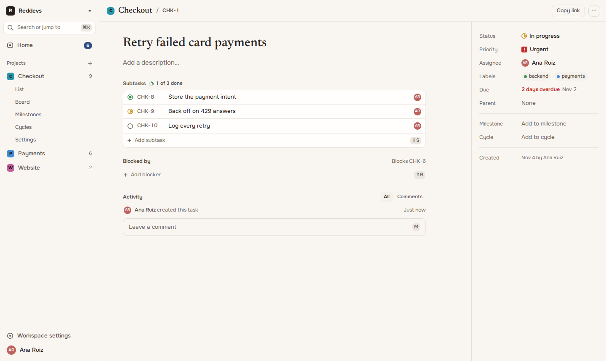

# Using the app

This page covers the web app as it is since 0.7.0: the sidebar, Home, the list and the board, the task view
and the peek, the command palette, and the four task fields (labels, due dates, blockers and subtasks). The
keys are in [keyboard.md](keyboard.md).

## Sidebar

The sidebar on the left holds, from top to bottom:
- the workspace menu (workspace settings, invite people, New project, New from Backlog.md);
- Search or jump to, which opens the command palette (⌘K, Ctrl+K on Windows and Linux);
- Home, with the number of things that need you;
- your projects, by name, each with its number of open tasks. The current project expands to List, Board,
  Milestones, Cycles and Settings (Milestones and Cycles only when the project uses them). The "+" next to
  Projects creates a project or a project from Backlog.md;
- Workspace settings;
- your menu: the theme (System, Light or Dark), My API keys, Keyboard shortcuts and Sign out.

`[` collapses the sidebar to icons and back. The app remembers your choice. Below 1100 pixels wide, the
sidebar stays collapsed.

The Dashboard, My tasks and Projects pages are gone. Their old links open Home.

## Home

Home (`/`) shows what needs attention, across every project you can see. It has three tabs:
- **Mine**: tasks in review that wait on you, unanswered comments that mention you, and your own open
  tasks that are blocked, overdue or simply assigned to you. Your tasks are the ones assigned to you, and
  the ones you created that nobody holds yet.
- **Everyone**: tasks in review, blocked, overdue and due this week, across the workspace.
- **Agents**: one card per agent (working or idle, its current task, what it did today and its last
  actions), and "Waiting on a person": questions and review requests from agents that nobody answered yet.

Each task shows once, in the first group it fits, in this order: Needs your review, Mentions, Blocked,
Overdue, Assigned to you. Mine and Everyone start with a deadlines strip: milestones and cycles that end
within 2 days, and tasks due within 2 days or overdue. "All clear" means nothing waits.

The count after Home in the sidebar is Mine's review, mentions, blocked and overdue items. Items leave on
their own when the reason clears: answer the comment, finish the review, close the blocker.

Filter Home by project, label and priority. Labels with the same name in several projects are one entry in
the filter. C on Home asks which project the new task goes to.

## List and board

Every project has a list and a board. The List / Board switch in the header, V, or G then L and G then B
change between them, and the project remembers the last one you used.

The header row holds the project name, the switch, Filter, Display, search (/), and New task. In a project
that mirrors Backlog.md, it also shows the mirror's state and Refresh now.

**Filter** adds conditions: status, priority, assignee, labels, due date (overdue, due soon, has a due date,
no due date), blocked, milestone and cycle. Active filters show as chips under the header, with the number
of matching tasks and Clear. Filters live in the page address, so a link keeps them.

**Display** sets how the view looks. You can change:
- the layout, list or board;
- the grouping (columns on the board): status, priority, assignee, milestone, cycle, label or none;
- swimlanes, on the board;
- the order: priority, due date, last updated, created, or manual (the board order you set by hand);
- subtasks: nested under their parent in the list, or as their own cards on the board;
- empty groups or columns, shown or hidden;
- "Hide done tasks after" a number of days (14 by default);
- which properties rows and cards show.

Display options are saved for you, per project and per view. Reset to default puts them back. By default
cards and rows show the key, the title, labels, subtask progress, the due date when set, the Blocked marker,
priority only when it is Urgent or High, and the assignee only when it is someone else.

In the list, Enter or a click opens the task view. Space opens the peek. ← and → on a group row fold and
unfold it. On the board, drag a card to another column, or press Shift+← and Shift+→. Shift+J and Shift+K
move a card up and down when the order is Manual. ⌘Z (Ctrl+Z) undoes the last move from the toast.

### Selecting several tasks

X selects the task under the cursor, Shift+click or Shift+↓ and Shift+↑ extend the selection, and ⌘A
selects everything in the view. With two or more tasks selected, a bar at the bottom changes their status,
assignee, labels, priority, due date, milestone or cycle in one go. The task keys (S, P, A, L, Shift+D …) act
on the whole selection too. Esc clears it.

Changes to several tasks work in native projects only. In a mirrored project the bar offers Copy keys, Copy
links and Open in Backlog.md.

## Task view and peek

A task opens as a full page at `/p/PAY/PAY-142`. The title and the Markdown description are on the left,
with the Subtasks and Blocked by boxes, then the activity and the comment box (M). The properties are on the
right: status, priority, assignee, labels, due date, parent, milestone and cycle, each with its picker.

E edits the title and D the description. J and K go to the next and previous task of the list or board you
opened it from ("12 of 40 in List"). Esc goes back there, with the task still under the cursor. Copy link
copies the task's address.

The peek opens over the list, the board or Home with Space. It shows the task's properties as chips and the
latest comment. J and K move it to the next task, Open goes to the task view, and Space or Esc closes it.

Old links to the list with `?task=PAY-142` open the task view.

## Command palette

⌘K (Ctrl+K) opens the palette from any page. Type to find:
- pages: Home, and the list, board, milestones, cycles and settings of each project;
- projects: G then P opens the palette on projects only;
- tasks, by key (`PAY-142`) or by words of the title;
- actions: create a task or a project, switch the theme, collapse the sidebar, open the shortcut list.
  Create task "…" starts quick create with the words you typed as the title.

On a task, or with tasks selected, the palette starts with their actions: Change status, Set priority,
Assign, Add labels, Set due date, Move to milestone, Add to cycle, Add blocker, Add subtask, Assign to me,
Copy key and Copy link. Some actions have a second step, such as Set status with the six statuses.
Backspace in an empty step goes back to the actions. The palette shows each action's key, so you learn them
as you go.

## Labels

Labels belong to one project. Type a name that doesn't exist in the label picker (L) and it creates the
label. Names are unique in the project, ignoring case, and up to 40 characters. The app picks one of nine
colours for a new label; Tab in the picker moves to the swatches if you want another.

Manage them in the project's Settings > Labels: the list shows how many tasks use each label. Rename a
label in place, change its colour, or delete it. Deleting asks first and says how many tasks lose the label;
the tasks keep everything else. Renames and deletes leave no history lines, and the task history keeps the
name it recorded.

## Due dates

A due date is a day, with no time. Set it with Shift+D: type a date ("nov 4", "tomorrow", "+3d",
"2026-11-20"), pick Today, Tomorrow or Next week, or a day in the calendar. Clear due date removes it.

Rows and cards show the date like this:

| When                         | Shows               |
| ---------------------------- | ------------------- |
| No due date                  | Nothing             |
| Later                        | Nov 14              |
| Within 2 days                | Tomorrow, In 2 days |
| Today                        | Today               |
| Past, and the task is open   | 3 days overdue      |
| Past, and the task is closed | Oct 31 · done       |

Days follow the server's `APP_TIME_ZONE` (UTC when it is not set).

## Blocked by

A task can wait on other tasks of the same project. Add them in the Blocked by box of the task view, or
with Shift+B. The blocker shows the other side: "Blocks PAY-150".

A task with at least one open blocker shows a Blocked marker. It is a marker only: nothing stops a blocked
task from changing status. Once every blocker is Done or Canceled, the marker goes away.

A link that would close a loop is refused with the reason, for example "Can't add: PAY-150 already waits on
PAY-142." A blocker that is hidden or that you can't see reads "Removed task".

## Subtasks

A task can have subtasks in the same project, one level deep: a subtask can't have subtasks of its own.
Add them in the Subtasks box of the task view or with Shift+S. Type a title and press ⌘Enter to create a new
subtask, or pick an existing task. A new subtask takes the parent's assignee.

The parent shows its progress as done of total, with canceled subtasks left out. In the list, subtasks can
nest under their parent. On the board they are hidden by default: the parent card reads "5 subtasks · 2
done" and expands in place to list them. Turn on "Show subtasks as cards" in Display to see them as cards.

## Projects that mirror Backlog.md

Mirrored projects show the same fields, filled from the task files: labels, due dates, blockers and the
parent. Every field that comes from the files is read-only. A small Backlog.md badge in the task view links
to the file, and a lock shows when you point at a field or try to change it. Fields with no place here sit
in "From the file" at the bottom of the properties. Comments and cycles stay editable. See
[backlog-md.md](backlog-md.md).
